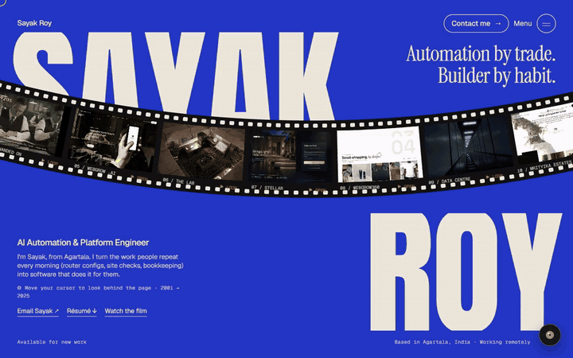

# Sayak Roy — Portfolio

The personal site of **Sayak Roy**, AI Automation & Platform Engineer, based in Agartala, Tripura, India and working remotely.

[](docs/walkthrough.mp4)

▶ **[Watch the full walkthrough (49 s, MP4)](docs/walkthrough.mp4)**

The site is one long scroll. Each part opens with its own transition, and every project in it can be opened and used.

## Run it

Needs Node.js 20 or newer.

```bash
npm install
npm run dev       # http://localhost:5173
npm run build     # type-check, then build to dist/
npm run preview   # serve the build at http://localhost:4173
```

## Media on Cloudinary

The heavy media (the film, project recordings, scenes and photos, about 47 MB) is served from Cloudinary with automatic format and quality, so the site itself ships under 1 MB. The code keeps plain paths like `"/live/webgrow.mp4"`; at build time a small Vite plugin (`vite.config.ts`) swaps each one for its Cloudinary URL from `cdn-manifest.json`.

To add or update media, put the file under `public/<folder>/` and run:

```bash
CLOUDINARY_URL=cloudinary://<api_key>:<api_secret>@<cloud_name> node scripts/cdn-upload.mjs
```

It uploads only new or changed files and updates the manifest. The secret is read from the environment and never written anywhere. Uploaded originals can then move to `_cdn_originals/` (ignored by git). Delete `cdn-manifest.json` to serve everything from `public/` again.

## What's on the page

| Part | What it does |
| --- | --- |
| **Hero** | A giant split name with one continuous strip of film carrying the work. The strip is drawn on a canvas, so the perforations run unbroken and each picture bends with the curve. Click a frame for its brief. A lens follows the cursor and looks *behind* the page at a lineup of Sayak at every age from 2001 to 2025, with the technology of each year. |
| **Works** | Opens behind sliding steel doors. Six projects stand as devices in front of giant plaster letters spelling WORKS, each screen playing the real project. Click one to open it full-screen. Live sites run inside the portfolio in a desktop or phone frame; MyChiffre opens as its real app screens. |
| **Handed On** | A 59-second narrated short film, introduced by an old-cinema iris and a 3-2-1 film leader. |
| **Experience** | Office blinds open onto a photoreal cutaway of one building with a room for each job (SRM, Accenture, Tata Communications, Derq). Scrolling moves the camera room to room; click a room to walk in, with links to each company's site. |
| **The lab** | The lights go out and a desk lamp lights the room. Every object is an experiment; hover to light it, click for the brief. |
| **Index** | Four more projects as big rows, each with a picture that follows the cursor, then a 3D rolodex of every other repository. |
| **Contact** | You fly through a giant HELLO into the contact screen. The footer is a crowd walking past behind the name. |

All 45 GitHub repositories are placed on the page **exactly once**. `src/data/work.ts` checks this in development and warns about anything missing or duplicated.

## Built with

- **Vite + React 19 + TypeScript**, Tailwind CSS v4
- **GSAP** (ScrollTrigger, SplitText) and **Lenis** smooth scroll for every scroll-driven animation
- **Canvas 2D** for the film strip, the footer crowd and the lens
- **Google Flow** (Nano Banana Pro, Veo) for the photoreal scenes, doors, rooms, the age lineup, and the shots of Sayak in the film, all generated from his own photos
- **[lemo-opuscar](https://github.com/lemomo-ai/lemo-opuscar)** for the film's narration, score and mix
- **[HyperFrames](https://github.com/heygen-com/hyperframes)** to compose and render the film

## Where things live

| What | Where |
| --- | --- |
| Page order and sections | `src/App.tsx` |
| Section transitions (doors, iris, blinds, lamp, HELLO) | `src/components/Gate.tsx` |
| Hero, film strip and lens | `src/components/Hero.tsx` |
| The WORKS scene and the project viewer | `src/components/WorksScene.tsx`, `src/components/ProjectViewer.tsx`, `src/data/showcase.ts` |
| Project briefs | `src/data/briefs.ts` |
| Every repository and where it appears | `src/data/projects.ts`, `src/data/work.ts` |
| Jobs and education | `src/data/profile.ts` |
| Footer crowd | `src/components/Crowd.tsx` |
| Résumé (PDF, HTML and LaTeX source) | `public/resume/` |

## Credits

- Footer crowd: [Open Peeps](https://www.openpeeps.com/) by Pablo Stanley (CC0), animated after [adxy.dev](https://adxy.dev/)'s footer ([minima](https://github.com/adxy/minima)).
- Hero layout and section transitions inspired by [abhayrohit.com](https://abhayrohit.com/).
- B-roll from Storyblocks.

© Sayak Roy. Code, writing and images are his. Please ask before reusing them.
